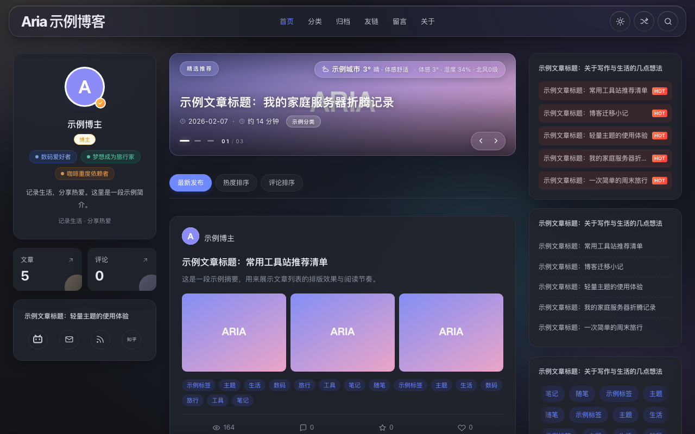
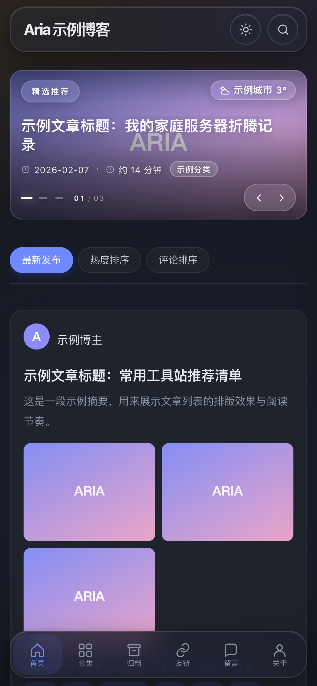
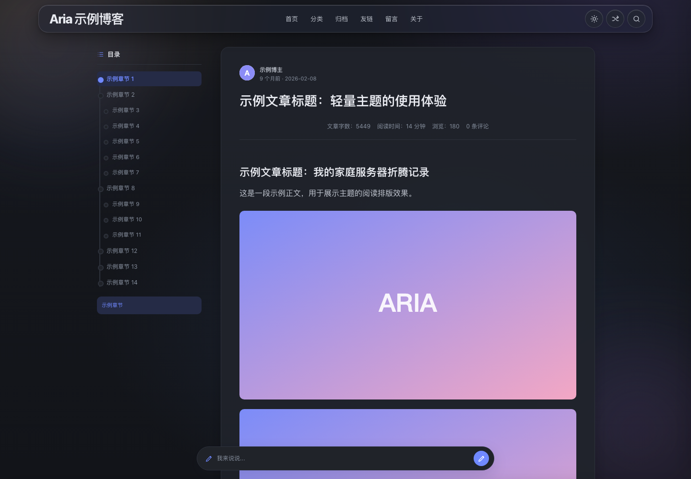
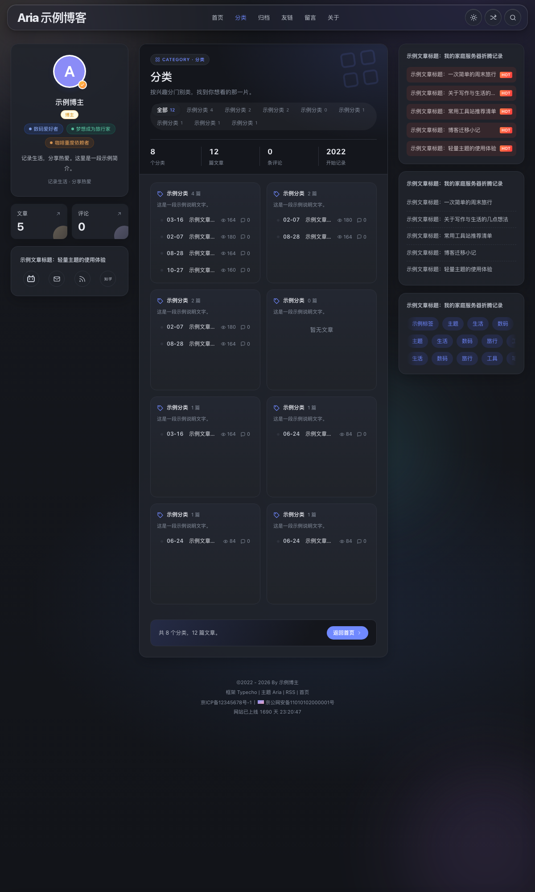
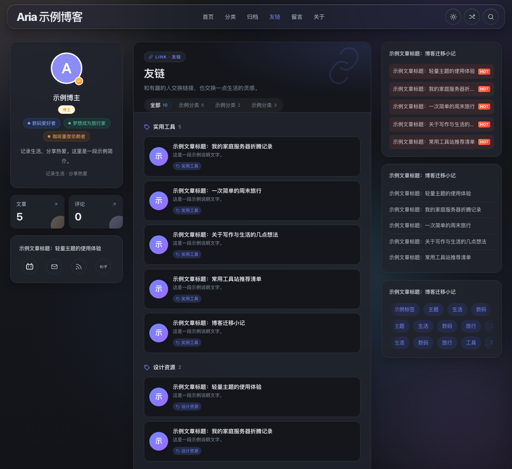
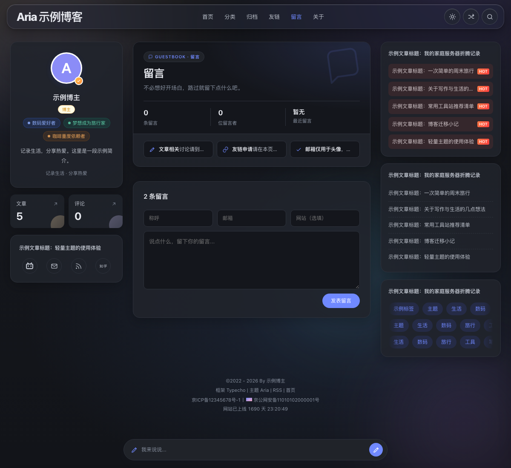

# Aria

<div align="center">

**一款轻量、现代的 Typecho 博客主题**

[](https://github.com/gaorkang/aria-typecho/releases)
[](https://typecho.org/)
[](LICENSE)

**🔗 Demo：[gaorkang.cn](https://gaorkang.cn/)**

</div>

Aria 是一款为 Typecho 设计的个人博客主题。它注重**阅读体验**与**访问速度**：原生 JavaScript，无 jQuery / Bootstrap 依赖；天气与 IP 归属地走本站服务端代理、使用国内接口；文章页采用沉浸式阅读布局，左侧目录 + 最佳阅读宽度正文。

## ✨ 特性

- **首页 Hero 轮播** — 置顶文章大图轮播，右上角单行玻璃天气条，按访客 IP 自动定位城市（国内 IP 库 + 中国天气网），服务端缓存 30 分钟
- **三栏卡片布局** — 左侧作者卡、中间文章流、右侧热门/图集/最新回复/随机文章/标签云/广告位，模块可独立开关
- **沉浸式阅读** — 文章页自动隐藏两侧卡片，正文宽度 702px、16px 字号、1.95 行高；左侧固定目录随滚动高亮当前章节，移动端收进浮动按钮
- **滚动淡入动画** — 卡片进入视口时缩放淡入，同屏元素错落触发，动画结束即释放 `will-change`；尊重「减少动态效果」系统偏好
- **深色模式 + 液态玻璃** — 顶栏与移动端底部导航采用 iOS/macOS 风格毛玻璃，支持浅色/深色切换并记住选择
- **评论增强** — 显示访客 IP 归属地与设备类型（Win / Mac / Linux / iOS / Android），头像走 Gravatar 国内镜像
- **独立页面** — 友链（申请弹窗，直接写入 Typecho 评论表单上下文）、归档、关于（时间轴 + 访客计数）、留言板、分类页
- **分类页** — 分类卡片统一高度，文章超出自动折叠为「更多 →」跳转分类归档
- **页脚信息** — 版权、框架/主题署名、ICP 与公安备案、秒级实时运行时间
- **SEO 增强（v1.1）** — 唯一 canonical、Open Graph / Twitter Card、JSON-LD（WebSite + BlogPosting）、站长验证 meta、百度推送；兼容日期式固定链接，附站点根目录 `sitemap.php` 生成器
- **作者兴趣标签（v1.1）** — 徽章下方可配置多枚彩色胶囊标签；favicon 支持 SVG / 32 / 180 / ICO 多端适配
- **轻量** — 全站仅 1 个 CSS + 1 个 JS，无外部前端库，原生 IntersectionObserver 实现动画

## 📷 截图

| 桌面首页 | 移动端首页 |
| :---: | :---: |
|  |  |

| 文章沉浸阅读 | 分类页 |
| :---: | :---: |
|  |  |

| 友链页 | 留言板 |
| :---: | :---: |
|  |  |

## 📦 安装

1. 下载本仓库的 ZIP 包（或 `git clone` 后把 `Aria-Typecho` 目录压缩）
2. 解压到 Typecho 安装目录的 `usr/themes/` 下，确保目录名为 `Aria-Typecho`
3. 登录 Typecho 后台 → **外观（控制台 → 外观）** → 启用 **Aria**
4. 在 **外观 → 主题设置** 中配置站点信息、社交链接、侧栏模块等

> 需要 PHP 7.2+ 与 Typecho 1.2+。天气/IP 归属地代理使用 `cURL` 或 `allow_url_fopen`，两者都没有时会自动降级隐藏对应功能。

## 🚀 v1.1.0 更新

> **v1.1.1**：所有演示配置改为无个人信息的示例值（`example.com` / `hello@example.com` / 示例备案号），截图同步替换为示例版，favicon 改为通用「A」图标；功能与 v1.1.0 一致。

- 新增 `seo.php`：输出唯一 canonical、Open Graph / Twitter Card、JSON-LD（WebSite + BlogPosting）、站长验证 meta 与百度推送；后台可配置
- 兼容日期式固定链接 `YYYY/MM/DD/slug/`：`ar_post_url()` 补齐 year/month/day，卡片与 sitemap 不再出现 `{year}` 占位符
- 新增 `sitemap.php`（站点根目录辅助文件，**不属于主题目录**，安装 ZIP 不含）：直读 Typecho SQLite 生成 XML。放到站点根目录后，nginx 加 `location = /sitemap.xml { rewrite ^/sitemap.xml$ /sitemap.php last; }`，并让 `robots.txt` 指向它；数据库不在默认位置时可用环境变量 `TYPECHO_DB` 指定
- favicon 改为站点头像圆形裁切，同步提供 SVG / 32px / 180px / ICO；作者卡新增 `profileTags` 兴趣标签（一行一个）
- 安全建议：把 Typecho 后台目录改成一段随机字符串，并同步修改 `config.inc.php` 里的 `__TYPECHO_ADMIN_DIR__`

从 1.0 升级：覆盖主题文件后，到「外观 → 主题设置」**重新保存一次**，让新增的 `profileTags` / `ogImage` / `siteVerification` / `seoBaiduPush` 等选项写进数据库（Typecho 不会自动为已有配置写入新字段的默认值）。

## 🧩 页面模板

主题的独立页面需要在后台「新建页面」时选择对应模板：

| 页面 | 模板 | 说明 |
| :--- | :--- | :--- |
| 关于 | `about.php` | 标语、时间轴、访客统计、留言入口 |
| 归档 | `archives.php` | 按年份/月份归档文章 |
| 分类 | `categories.php` | 分类卡片墙，统一高度 + 更多跳转 |
| 友链 | `links.php` | 分组友链 + 申请弹窗（写入 Typecho 原生评论） |
| 留言板 | `guestbook.php` | 基于 Typecho 评论的留言板 |

建议为友链申请和留言分别建立独立页面，并在「主题设置 → 留言板链接」中填入留言板页面地址。

## ⚙️ 主题设置

所有配置集中在后台「外观 → 主题设置」，主要分组：

- **基础信息** — LOGO 文字、头像、作者名/徽章/简介、社交链接
- **侧栏内容** — 公告、热门文章、图集、友链分组、建站历程、关于页标语
- **模块开关** — 右侧栏模块（热门/图集/最新回复/随机/标签云/广告位）、功能开关（浏览数/目录/灯箱/阅读进度）、增强功能（置顶/排序/光球/淡入动画/扫光/心跳）
- **首页增强** — 置顶文章 CID、天气城市、广告代码
- **页脚** — ICP / 公安备案及图标、版权起始年份、自定义页脚文字
- **其他** — 付费提示、留言板链接、Gravatar 镜像地址

常用配置格式：

```
社交链接      名称|链接|图标标识        一行一个，图标支持 bilibili/email/rss/zhihu/github/youtube/weibo
热门文章      标题|链接                 一行一个
图集          图片地址|跳转地址         一行一个，跳转地址可省略
友情链接      分组|名称|链接|头像|简介   一行一个，头像可省略
建站历程      日期|标题|描述            一行一个，如 2026.02|改名为本站|说明文字
置顶文章 CID  12,8,5                   多个用英文逗号分隔，最多 6 篇
天气城市      off                      留空按 IP 定位；填中文城市名固定显示；填 off 关闭
```

## 🏷️ 文章自定义字段

写文章时可在编辑页下方设置：

| 字段 | 说明 |
| :--- | :--- |
| `thumb` | 文章缩略图，留空自动取正文第一张图 |
| `likes` | 初始喜欢数 |
| `stars` | 初始收藏数 |

浏览数使用自定义字段 `views`（需在「功能开关」中启用浏览数统计）。

## 🔧 技术实现

- **零前端依赖**：原生 JS + CSS 变量，动画使用 `IntersectionObserver` 与 CSS `@keyframes`，不引入 AOS / jQuery / Bootstrap
- **国内接口**：天气数据来自中国天气网，IP 归属地走国内 IP 库，评论头像用 `cravatar.cn` 镜像，全部经 `weather.php` / `ipinfo.php` 服务端代理并缓存
- **渐进增强**：无 JS 时内容照常显示；不支持 `IntersectionObserver` 时动画直接展示终态；开启系统「减少动态效果」时自动关闭动画
- **响应式**：桌面三栏 / 平板双栏 / 移动单栏，移动端底部常驻玻璃导航，兼容 iPhone 安全区
- **轻量体积**：主题目录约 750 KB（含截图），核心 CSS ~84 KB、JS ~37 KB，前台仅 2 个静态资源请求

## 📄 许可证

[MIT License](LICENSE) © 2026 gaorkang

Free for personal and commercial use. 保留版权声明即可自由使用、修改和分发。

## 🙏 致谢

Aria 在界面设计与交互思路上参考了开源 Typecho 主题 **Robes**（[robes.xin](https://robes.xin/)、[使用文档](https://robes.xin/1180.html)）——包括液态玻璃风格、Hero 大图轮播与天气条、首页排序切换、文章页目录、友链/归档/关于/留言板等页面形态。感谢 Robes 作者的开源分享。

Aria 的代码为独立编写实现（原生 JS + CSS，未使用 Robes 的源码或前端库），并在轻量化和阅读体验上做了自己的取舍：去掉 PJAX / 图集瀑布流等重型特性，改用国内接口的服务端代理、沉浸式阅读布局与 IntersectionObserver 动画。

Aria 的开发由 **HY4 模型**（腾讯混元 Hy）协助完成——从主题架构、样式与交互实现，到数据迁移和逐轮细节打磨。感谢 HY4 在代码编写与调试中的全程支持。

同时感谢 Typecho 社区，以及所有提供反馈和帮助的朋友。
